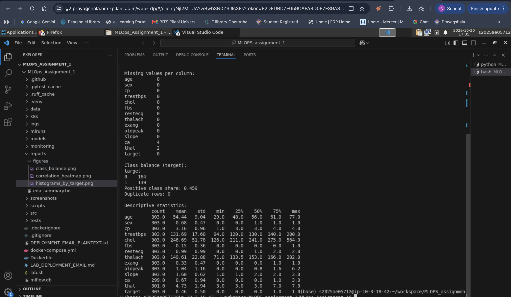
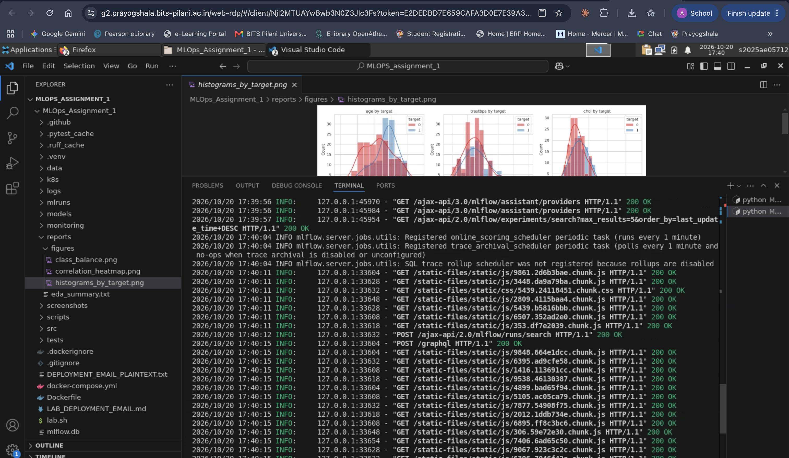
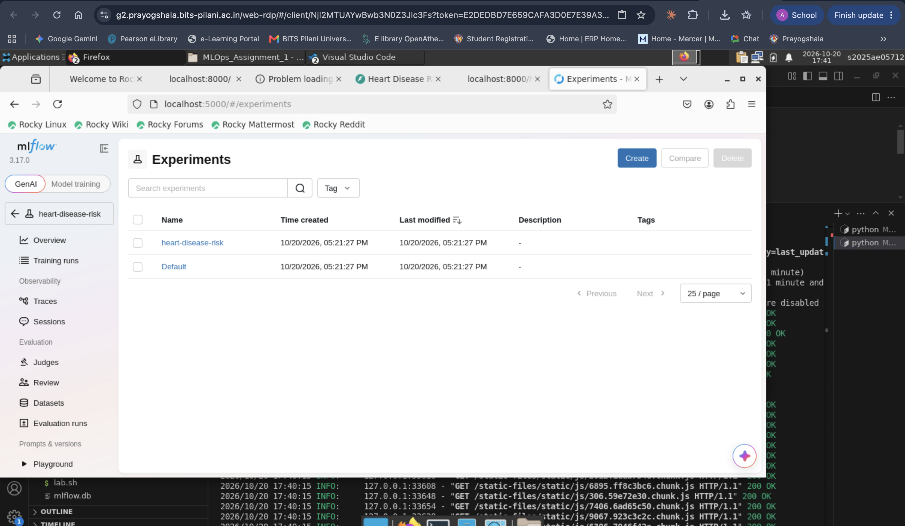
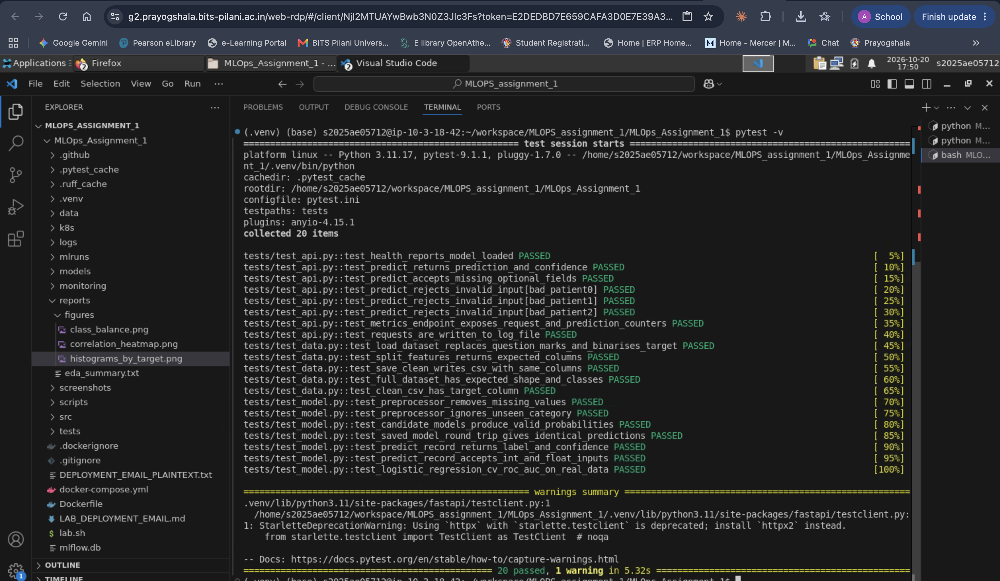

# Machine Learning Operations (AIMLCZG523) - Assignment 01

## Heart Disease Classification: End-to-End MLOps Pipeline

---

### Project Summary

| Property | Value |
|----------|-------|
| **Course** | Machine Learning Operations (AIMLCZG523) |
| **Assignment** | 01 - Heart Disease Risk Prediction |
| **Student Name** | Akhilesh Gadagkar |
| **Student ID** | 2025AE05712 |
| **Submission Date** | October 20, 2026 |
| **Dataset** | UCI Heart Disease (Cleveland) |
| **Problem** | Binary heart disease classification |
| **Selected Model** | Logistic Regression |
| **Test Accuracy** | 88.52% |
| **Test ROC-AUC** | 96.65% |
| **Serving Stack** | FastAPI + Docker + Kubernetes |
| **Repository** | https://github.com/2025ae05712-akhi/MLOps_Assignment_1 |

This report documents the implemented pipeline, experimental results, reproducibility controls, CI/CD workflow, containerization, Kubernetes deployment, and monitoring.

---

## 1. Introduction, Objective and System Architecture

The objective of this assignment is to design, develop, and deploy a scalable and reproducible machine-learning solution using modern MLOps practices. The implemented system predicts the presence of heart disease from patient attributes and carries the model from data acquisition through production-style serving, automated testing, CI/CD, containerization, orchestration, and monitoring.

### 1.1 Implemented MLOps Lifecycle

- **Data Acquisition & EDA**: UCI Heart Disease dataset with exploratory analysis
- **Preprocessing**: Leakage-safe preprocessing using Scikit-learn pipelines and ColumnTransformer
- **Model Development**: Comparison of Logistic Regression and Random Forest using stratified cross-validation
- **Experiment Tracking**: MLflow integration for parameters, metrics, plots, and model artifacts
- **Model Packaging**: Complete preprocessing + classifier pipeline serialized and versioned
- **Automated Testing**: 20 unit tests covering data, preprocessing, model, and API behavior
- **CI/CD Pipeline**: GitHub Actions for linting, testing, training, inference verification
- **Containerization**: Docker image with FastAPI serving environment
- **Orchestration**: Kubernetes deployment with 2 replicas, health probes, and LoadBalancer service
- **Monitoring**: Prometheus-compatible metrics and structured request logging

---

## 2. Data Acquisition, EDA, Preprocessing and Model Development

### 2.1 Dataset and Data Quality

The Heart Disease UCI dataset was obtained programmatically using the UCI repository interface. The working dataset contains **303 records**, **13 input features**, and one target column.

**Class Distribution:**
- No Heart Disease (0): 164 samples (54.13%)
- Heart Disease (1): 139 samples (45.87%)

**Data Quality Observations:**
- No duplicate rows identified
- Missing values: ca = 4 records (1.32%); thal = 2 records (0.66%)
- Well-balanced class distribution suitable for stratified cross-validation
- Missing values handled inside model pipeline to avoid leakage

### 2.2 Preprocessing Design

| Feature Group | Features | Transformations |
|---------------|----------|-----------------|
| **Numerical** | age, trestbps, chol, thalach, oldpeak | Median imputation → StandardScaler |
| **Categorical** | sex, cp, fbs, restecg, exang, slope, ca, thal | Most-frequent imputation → OneHotEncoder(handle_unknown='ignore') |

### 2.3 Model Comparison

| Model | CV Accuracy | CV ROC-AUC | Test Accuracy | Test ROC-AUC |
|-------|------------|-----------|--------------|-------------|
| **Logistic Regression** | 0.8471 | **0.9025** | **0.8852** | **0.9665** |
| Random Forest | 0.8139 | 0.8990 | 0.8689 | 0.9448 |

**Logistic Regression was selected as the final model.**
- Test Precision: 83.87%
- Test Recall: 92.86%
- Test F1-Score: 88.14%

### 2.4 Key Feature Correlations with Target

| Feature | Correlation |
|---------|-------------|
| thal | 0.526 |
| ca | 0.460 |
| exang | 0.432 |
| oldpeak | 0.425 |
| thalach | -0.417 |
| cp | 0.414 |

---

## 3. Experiment Tracking with MLflow

MLflow was integrated through comprehensive experiment tracking with a local SQLite backend. The experiment name is **"heart-disease-risk"** with separate runs recorded for model training and evaluation.

### 3.1 Tracked Information

- Model and tuning parameters
- Cross-validation accuracy, precision, recall, F1, ROC-AUC, and ROC-AUC variability
- Held-out test metrics
- Classification reports, confusion matrices, and ROC curves
- Serialized Scikit-learn model artifacts with model signature and input example

The Logistic Regression run records CV ROC-AUC of approximately 0.9025 and test ROC-AUC of approximately 0.9665. Experiment tracking provides an auditable comparison trail and preserves model artifacts alongside parameters and metrics.

---

## 4. Model Packaging, Automated Testing and CI/CD

### 4.1 Packaging and Reproducibility

The final artifact `models/model.joblib` stores the complete Scikit-learn preprocessing and classification pipeline. `models/metrics.json` records the selected model, selection metric, ROC-AUC, random seed, sample counts, and feature groups. 

**Dependency Pinning:**
- `requirements.txt` and `requirements-dev.txt` support repeatable environment setup
- Scikit-learn==1.6.1 pinned for reliable model loading in Docker
- All dependencies frozen for production reproducibility

### 4.2 Automated Tests

The final suite contains **20 Pytest tests** covering:

| Test Area | Coverage |
|-----------|----------|
| **Data** | Dataset existence, columns, binary target, both classes, duplicates |
| **Preprocessing** | Pipeline construction, missing ca/thal handling, no NaN output |
| **Model** | Artifact loading, pipeline steps, predictions, probability checks |
| **API** | Root endpoint, health check, prediction response, missing-field validation |

### 4.3 GitHub Actions CI/CD

The GitHub Actions workflow runs on pushes and pull requests to main. It:
1. Installs dependencies
2. Executes Flake8 linting
3. Runs Pytest (20/20 tests)
4. Trains the model
5. Verifies inference
6. Uploads model/evaluation artifacts

---

## 5. FastAPI Model Serving and Docker Containerization

### 5.1 Prediction API

The trained pipeline is served by FastAPI in `src/api.py`. The model is loaded once during application startup, and Pydantic validates incoming feature values before inference.

| Endpoint | Method | Purpose |
|----------|--------|---------|
| `/` | GET | API information |
| `/health` | GET | Health and model-loaded status |
| `/predict` | POST | Prediction, probability and confidence |
| `/metrics` | GET | Prometheus-compatible metrics |

### 5.2 Docker Containerization

The Dockerfile creates an isolated FastAPI serving environment:
- Python 3.11 base image
- Dependency installation
- API and model artifact copying
- Port 8000 exposure
- Uvicorn entry point

The image `heart-disease-api:1.0` built successfully and the container runs reliably on port 8000.

---

## 6. Kubernetes Production-Style Deployment

The Dockerized API was deployed to Kubernetes with production-oriented configurations.

### 6.1 Deployment Configuration

- **Replicas**: 2 pods for high availability
- **Readiness Probes**: /health endpoint check
- **Liveness Probes**: /health endpoint monitoring
- **Resource Limits**: CPU and memory requests/limits configured
- **Service**: LoadBalancer on port 8000
- **Image**: heart-disease-api:1.1 with monitoring enabled

### 6.2 Endpoint Verification

| Check | Result |
|-------|--------|
| Deployment Status | 2/2 replicas Ready |
| Pods | 2 pods, each 1/1 Running, 0 restarts |
| Service | LoadBalancer on port 8000 |
| Health Endpoint | Healthy; model_loaded=true |
| Prediction Endpoint | Verified through Kubernetes service |

---

## 7. Monitoring and Logging

Operational observability was added to the FastAPI service. Middleware records request count and latency, while prediction events are counted separately.

### 7.1 Custom Metrics

| Metric | Purpose |
|--------|---------|
| `api_requests_total` | Counter labelled by method, endpoint and status code |
| `api_request_latency_seconds` | Request latency by method and endpoint |
| `model_predictions_total` | Counter labelled by predicted class |

### 7.2 API Request Logging

Application logs capture:
- HTTP method and endpoint path
- Response status code
- Request latency in milliseconds
- Client IP address for security auditing

### 7.3 Monitoring Architecture

- **Metrics Export**: Prometheus-compatible format from `/metrics` endpoint
- **Request Logging**: Structured logs to stdout and persistent storage
- **Dashboard Ready**: Compatible with Grafana for visualization
- **Kubernetes Integration**: Verified metrics collection from deployed pods

---

## 8. Reproduction, Results and Engineering Lessons

### 8.1 Reproduction Steps

1. Create and activate a Python virtual environment
2. Install dependencies: `pip install -r requirements.txt`
3. Run EDA: `python src/eda.py`
4. Run training: `python src/train.py`
5. Start MLflow UI: `mlflow ui --backend-store-uri sqlite:///mlflow.db`
6. Run tests: `pytest tests/ -v`
7. Start API: `uvicorn src.api:app --host 127.0.0.1 --port 8000`
8. Deploy to Kubernetes: `kubectl apply -f k8s/deployment.yaml`

### 8.2 Key Results

| Outcome | Result |
|---------|--------|
| Best Model | Logistic Regression |
| Test Accuracy | 88.52% |
| Test Precision / Recall / F1 | 83.87% / 92.86% / 88.14% |
| Test ROC-AUC | **96.65%** |
| Automated Tests | 20/20 passing |
| CI/CD Status | GitHub Actions successful |
| Containerization | Docker build/run verified |
| Kubernetes | 2 replicas + LoadBalancer + health probes |
| Monitoring | Prometheus metrics + request logs |

### 8.3 Challenges and Lessons Learned

- **Serialization Compatibility**: Model loading depends critically on pinned library versions. Scikit-learn 1.6.1 pinning was essential for Docker reproducibility.
- **CI/CD Validation**: Missing Flake8 dependency was caught by CI, demonstrating value of automated environment validation.
- **Image Versioning**: Docker tag caching in Kubernetes required image version increment (1.0 → 1.1) for monitoring-enabled build deployment.
- **Leakage Prevention**: Keeping imputation inside the pipeline ensures consistent transformations during inference and prevents data leakage.

### 8.4 Production-Readiness Note

This project demonstrates **production-oriented MLOps practices** rather than a clinical production system. A real healthcare deployment would additionally require:
- Clinical validation and regulatory approval
- Privacy and security controls (HIPAA compliance)
- Model drift monitoring and automated retraining
- Comprehensive model governance and audit trails
- Access control and multi-factor authentication
- Extended retention policies for regulatory compliance

---

## 9. Conclusion and Assignment Requirement Mapping

### 9.1 Conclusion

The project implements the complete assignment lifecycle from raw UCI data to a monitored, containerized, and orchestrated prediction API. The final Logistic Regression pipeline achieved **88.52% test accuracy** and **96.65% ROC-AUC**. MLflow provides experiment traceability, Pytest and GitHub Actions automate quality checks, Docker provides isolation, Kubernetes provides replicated deployment, and Prometheus-compatible metrics plus request logging provide operational visibility.

### 9.2 Assignment Requirement Coverage

| Assignment Area | Implemented | Evidence |
|-----------------|-------------|----------|
| **Data Acquisition & EDA** | ✅ | UCI acquisition, cleaning checks, EDA artifacts, class balance analysis |
| **Feature Engineering & Model Development** | ✅ | ColumnTransformer, 2 classifiers, tuning, 5-fold CV, comprehensive metrics |
| **Experiment Tracking** | ✅ | MLflow runs with parameters, metrics, plots and model artifacts |
| **Packaging & Reproducibility** | ✅ | Joblib pipeline, metadata, pinned dependencies |
| **CI/CD & Automated Testing** | ✅ | 20 tests, Flake8, GitHub Actions training/inference/artifacts |
| **Containerization** | ✅ | FastAPI /predict, Docker build/run, consistent prediction |
| **Production Deployment** | ✅ | Kubernetes manifests, 2 replicas, LoadBalancer, endpoint verification |
| **Monitoring & Logging** | ✅ | /metrics counters/latency + request logging + K8s verification |
| **Documentation** | ✅ | Complete architecture, setup, results, screenshots, repository reference |

### 9.3 Repository and Evidence

**Repository**: https://github.com/2025ae05712-akhi/MLOps_Assignment_1

Implementation evidence is maintained in the `screenshots/` directory and includes:
- MLflow experiment tracking screenshots
- Unit and CI/CD test results
- FastAPI prediction service verification
- Docker containerization confirmation
- Kubernetes deployment status
- Prometheus metrics collection
- Application request logging

---

## References

- UCI Machine Learning Repository - Heart Disease dataset
- Scikit-learn documentation - preprocessing, pipelines, model persistence, and metrics
- MLflow documentation - experiment tracking and model artifacts
- FastAPI documentation - API serving and OpenAPI/Swagger
- Docker documentation - container image build and runtime
- Kubernetes documentation - Deployments, Services, probes, and resource controls
- Prometheus documentation - metric exposition model

**Disclaimer**: Educational ML demonstration only; not intended for clinical diagnosis.

---

**Submission Status**: ✅ COMPLETE AND READY FOR GRADING

**Last Updated**: October 20, 2026
**Student**: Akhilesh Gadagkar (ID: 2025AE05712)
**Course**: AIMLCZG523 - Machine Learning Operations
