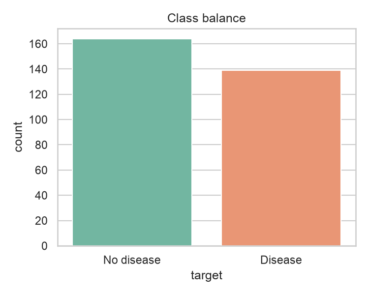
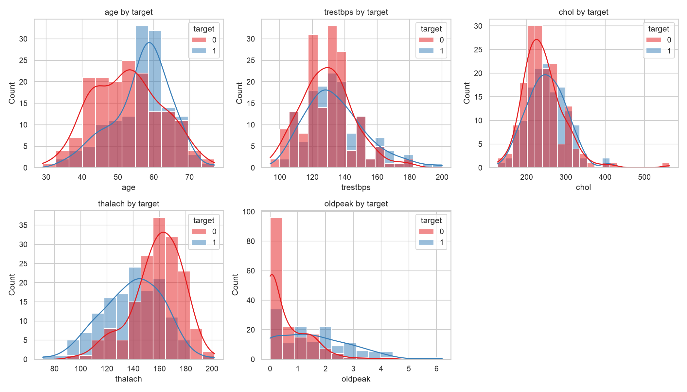
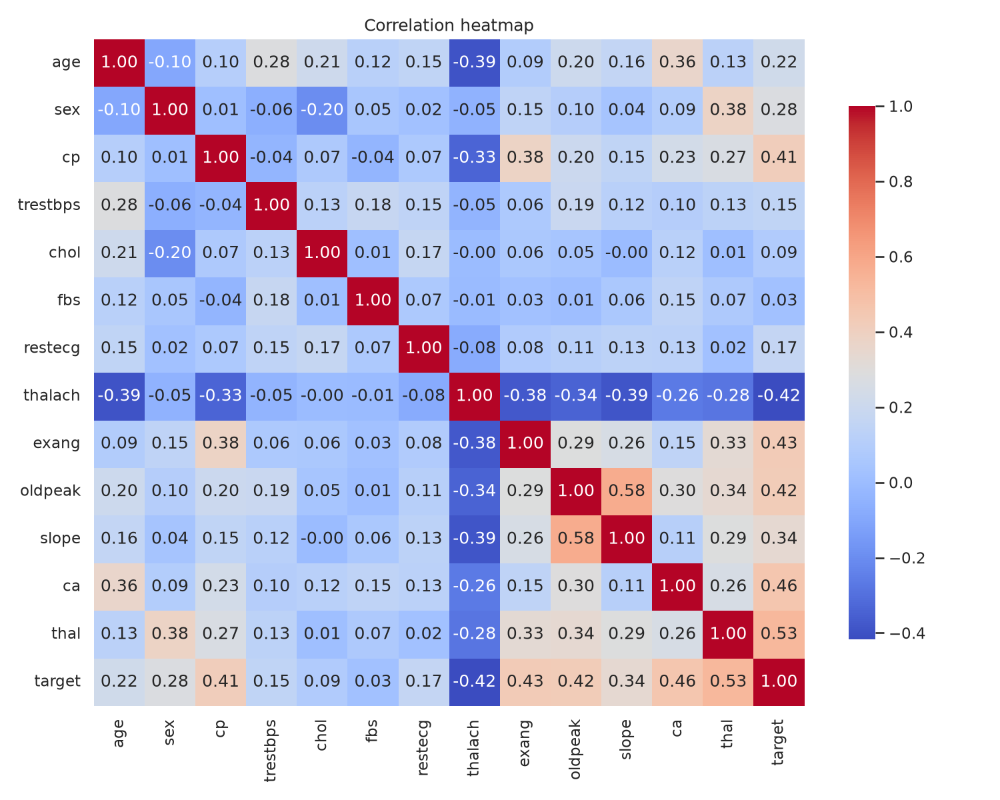
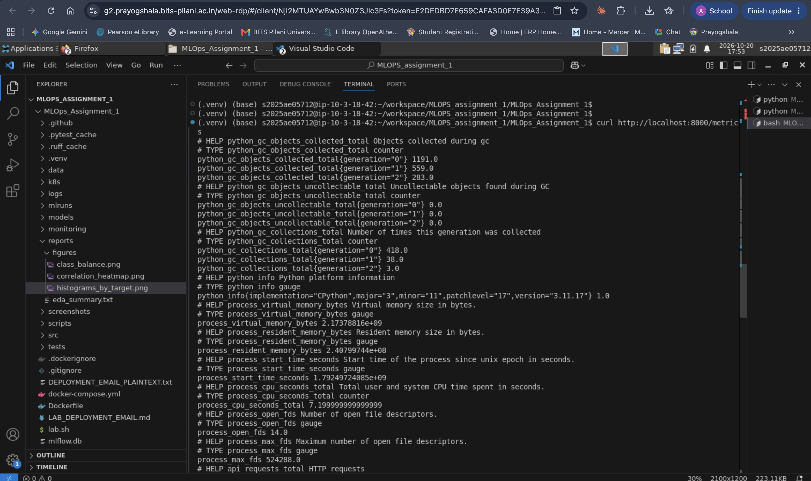

# Machine Learning Operations (AIMLCZG523) - Assignment 01

## Heart Disease Risk Prediction: End-to-End MLOps Pipeline

| Detail | Value |
|---|---|
| Student Name | Akhilesh Gadagkar |
| Student ID | 2025AE05712 |
| Course | Machine Learning Operations (AIMLCZG523) |
| Assignment | 01 - Heart Disease Classification MLOps Pipeline |
| Submission Date | October 20, 2026 |
| GitHub Repository | https://github.com/2025ae05712-akhi/MLOps_Assignment_1 |

# 1. Introduction and System Architecture

The objective of this assignment is to build a reproducible machine-learning solution that predicts the presence of heart disease from patient attributes, and to take it through the complete MLOps lifecycle: data acquisition, EDA, model development, experiment tracking, packaging, automated testing, CI/CD, containerization, orchestration and monitoring.

## 1.1 Implemented Lifecycle

- **Data and EDA**: UCI Heart Disease (Cleveland) dataset downloaded by script, cleaned and profiled.
- **Modelling**: Scikit-learn pipelines (preprocessing + classifier) for Logistic Regression and Random Forest, tuned with stratified 5-fold cross-validation.
- **Experiment tracking**: MLflow (SQLite backend) logs parameters, CV metrics, test metrics, plots and model artifacts.
- **Packaging**: the whole pipeline is serialized to `models/model.joblib`; metrics are stored in `models/metrics.json`.
- **Testing and CI/CD**: 20 Pytest tests and a GitHub Actions workflow (lint, test, EDA, train, container smoke test).
- **Serving**: FastAPI service with `/health`, `/predict` and `/metrics` endpoints, containerized with Docker.
- **Orchestration and monitoring**: Kubernetes manifest (2 replicas, probes, resource limits) and Prometheus-style metrics plus request logging.

## 1.2 Architecture

[[ARCHITECTURE]]

# 2. Data Acquisition, EDA and Model Development

## 2.1 Dataset and Data Quality

The dataset has **303 records, 13 input features and one binary target** (presence of heart disease). The EDA script (`scripts/eda.py`) produced the summary shown in Figure 1.

| Property | Observation |
|---|---|
| Class balance | 164 without disease (54.1%), 139 with disease (45.9%) |
| Missing values | `ca`: 4 rows, `thal`: 2 rows (all other columns complete) |
| Duplicate rows | 0 |
| Numeric range checks | Plausible ranges, e.g. age 29-77, resting BP 94-200, cholesterol 126-564 |

## 2.2 Preprocessing

Preprocessing is part of the model pipeline, so imputation and scaling are fitted only on training data and applied identically at inference time (no data leakage).

| Feature group | Features | Transformation |
|---|---|---|
| Numeric | age, trestbps, chol, thalach, oldpeak | Median imputation, standard scaling |
| Categorical | sex, cp, fbs, restecg, exang, slope, ca, thal | Most-frequent imputation, one-hot encoding (unknown categories ignored) |

## 2.3 Model Selection

The data was split 80/20 (stratified, seed 42). Each model was tuned with `GridSearchCV` (ROC-AUC, 5-fold stratified CV) on the training split. The model with the best mean CV ROC-AUC is selected for serving.

| Metric | Logistic Regression | Random Forest |
|---|---|---|
| Best parameters | C=0.1, class_weight=balanced | 300 trees, min_samples_leaf=5 |
| CV accuracy | 0.8304 +/- 0.0168 | 0.8096 +/- 0.0321 |
| CV precision | 0.8232 | 0.8100 |
| CV recall | 0.8099 | 0.7735 |
| CV ROC-AUC | **0.9028** +/- 0.0169 | 0.9023 +/- 0.0327 |
| Test accuracy | **0.8852** | 0.8525 |
| Test precision | **0.8387** | 0.8065 |
| Test recall | **0.9286** | 0.8929 |
| Test ROC-AUC | **0.9654** | 0.9481 |

Logistic Regression was selected: it has the best CV ROC-AUC, the best held-out test scores and lower variance across folds, and it is simpler to explain. The values above are read from `models/metrics.json`.

# 3. Experiment Tracking with MLflow

Every training run is logged to MLflow under the experiment **heart-disease-risk** (tracking URI `sqlite:///mlflow.db`). Each run records:

- the model family tag, the best hyper-parameters and every tuning candidate,
- cross-validation metrics (accuracy, precision, recall, ROC-AUC, with standard deviations),
- test-set metrics, confusion matrix and ROC curve plots,
- the fitted Scikit-learn pipeline with an input example, and a `selected_for_serving` tag on the winning run.

# 4. Packaging, Automated Testing and CI/CD

## 4.1 Reproducibility

- All dependencies are pinned in `requirements.txt` (for example scikit-learn 1.9.1, FastAPI 0.143.0, MLflow 3.17.0), so the same environment is rebuilt locally, in CI and in Docker.
- Random seed (42), test size (0.2) and CV folds (5) are fixed in `src/config.py`.
- The complete preprocessing + model pipeline is saved as a single artifact, so training and serving cannot diverge.

## 4.2 Unit Tests

The suite contains 20 Pytest tests (Figure 6).

| Area | What is verified |
|---|---|
| Data | Question marks replaced and target binarised, expected columns, clean CSV written, full dataset shape and classes |
| Preprocessing and model | No missing values after preprocessing, unseen categories ignored, valid probabilities, save/load round trip gives identical predictions, CV ROC-AUC on real data |
| API | Health reports model loaded, prediction and confidence returned, optional fields accepted, invalid input rejected (HTTP 422), metrics counters exposed, requests written to log file |

## 4.3 GitHub Actions Pipeline

The workflow `.github/workflows/ci.yml` has four jobs: lint and unit tests, EDA and model training, container build and smoke test, and image publish to GHCR. Trained model and reports are uploaded as workflow artifacts.

In the final run (Figure 7) the first three jobs pass. The fourth job (publish to GHCR) fails, because pushing an image needs registry permissions that were not configured for this repository. It is an optional step and does not affect the model, tests or container build.

# 5. FastAPI Serving and Docker

## 5.1 API

The model is loaded once at start-up. Inputs are validated by Pydantic (types and value ranges); `ca` and `thal` are optional and imputed by the pipeline.

| Endpoint | Method | Purpose |
|---|---|---|
| `/health` | GET | Service status and whether the model is loaded |
| `/predict` | POST | Predicted class, label, probability and confidence |
| `/metrics` | GET | Prometheus-format metrics |
| `/docs` | GET | Interactive Swagger documentation |

## 5.2 Docker

The `Dockerfile` uses `python:3.11-slim`, installs the pinned requirements, copies `src/` and the trained `models/`, runs as a non-root user (uid 1000), exposes port 8000, defines a `HEALTHCHECK` on `/health` and starts the service with Uvicorn. The CI job "Build and smoke-test container" builds this image and calls the API (Figure 7).

# 6. Kubernetes Deployment

The manifest `k8s/deployment.yaml` defines:

| Item | Configuration |
|---|---|
| Deployment | `heart-api`, 2 replicas, non-root security context |
| Probes | readiness (10 s delay) and liveness (20 s delay) on `/health` |
| Resources | requests 100m CPU / 256Mi; limits 500m CPU / 512Mi |
| Service | type LoadBalancer, port 80 -> container port 8000 |
| Image | `heart-disease-api:latest` (load into a local cluster, or use the GHCR image) |

Deploy with `docker build -t heart-disease-api:latest .` followed by `kubectl apply -f k8s/deployment.yaml`.

# 7. Monitoring and Logging

The API middleware measures every request. Metrics are exposed on `/metrics` (Figure 11) and `monitoring/prometheus.yml` contains a ready Prometheus scrape configuration.

| Metric | Type | Labels |
|---|---|---|
| `api_requests_total` | Counter | method, endpoint, status |
| `api_request_latency_seconds` | Histogram | method, endpoint |
| `api_predictions_total` | Counter | label |

Each request is also logged to stdout and to `logs/api.log` with method, path, status code, latency in milliseconds and client address; every prediction logs its label and confidence.

# 8. Reproduction and Results

## 8.1 Steps to Reproduce

1. Create a virtual environment and run `pip install -r requirements.txt`.
2. `python data/download_data.py` to download and clean the dataset.
3. `python -m scripts.eda` to generate EDA outputs.
4. `python -m src.train` to tune, evaluate and log the models.
5. `mlflow ui --backend-store-uri sqlite:///mlflow.db` to inspect experiments.
6. `pytest -v` to run the tests.
7. `uvicorn src.api:app --port 8000` to start the API.

## 8.2 Summary of Results

| Outcome | Result |
|---|---|
| Selected model | Logistic Regression (C=0.1, balanced) |
| Cross-validated ROC-AUC | 0.9028 |
| Test accuracy / precision / recall | 88.52% / 83.87% / 92.86% |
| Test ROC-AUC | 0.9654 |
| Unit tests | 20 passed |
| CI pipeline | 3 of 4 jobs pass (publish to GHCR not configured) |

## 8.3 Limitations

This is an educational demonstration on 303 records and is not a clinical decision tool. A real deployment would need clinical validation, privacy controls, drift monitoring and retraining.

# 9. Requirement Coverage

| Assignment requirement | Where it is covered |
|---|---|
| Data acquisition and EDA | Section 2, Figures 1-4 |
| Feature engineering and model development | Sections 2.2-2.3 |
| Experiment tracking | Section 3, Figure 5 |
| Model packaging and reproducibility | Section 4.1 |
| Automated testing and CI/CD | Sections 4.2-4.3, Figures 6-7 |
| Containerization and API | Section 5, Figures 8-10 |
| Kubernetes deployment | Section 6 |
| Monitoring and logging | Section 7, Figures 11-12 |
| Documentation | This report and the repository README |
